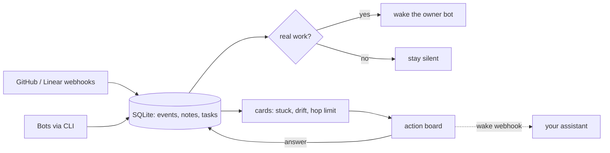

# Agent Board

A small, event-driven task board for a team of AI coding bots and one human.

**Live site:** https://aribennett1.github.io/agent-board/

## The problem

If you run several AI coding bots (a planner, an engineer, a reviewer) the obvious setup is routines that wake up on a timer and poll. It goes wrong in predictable ways:

- **It burns usage.** Most wake-ups find nothing to do, and each one pays for a full context load.
- **Work gets lost.** Nobody owns the handoff, so tasks stall between bots and nobody notices.
- **State drifts.** The bots' idea of a task falls out of sync with the issue tracker and GitHub.
- **The human becomes the scheduler.** You chase bots, re-ask questions, and watch for loops.

## The approach

Scripts do everything they can for free. A bot is woken only when there is real work for it.

- **Event-driven, with scripts as backstops.** GitHub and Linear webhooks, notes and state changes are events. An hourly `tick` catches whatever slipped through.
- **A SQLite notes table.** Every note carries its author. A trigger refuses an update or delete by the wrong author, and notes are append-only (an edit is a new note that supersedes the old one).
- **One wake per task per 30-second batch**, only to the current owner, never to the bot that caused the event.
- **Liveness check-ins.** A woken bot must check in within 2 minutes and write something within 20. Otherwise: one re-wake, then a card for the human.
- **Hop limits.** After 2 review rounds with no pass the script stops waking bots and hands the task to the human.
- **A drift check** compares the board with the tracker and GitHub and raises a card on any mismatch.
- **A weekly bottleneck report** shows wakes, estimated tokens per bot, re-wakes, hop-limit hits and where time was spent waiting.
- **The action board is the human's single inbox.** Anything that needs a person lands there, and a red dot in the tab tells you to come back. Answers go to the owning bot, and you can message the assistant from any text box, by typing or by voice.



## Quick start

Needs Node 22.18 or newer.

```sh
npm run setup            # installs both packages and builds the React UI into ui/dist
cp .env.example .env     # optional, every setting has a default
npm start                # board UI, webhooks and API on http://localhost:8787
```

Add a task and look at it:

```sh
export AGENT_BOT=human
node bin/board.ts task add T1 --title "Choose a database" --state waiting_human
node bin/board.ts note T1 --kind info "Postgres or SQLite?"
```

Open http://localhost:8787. The tab shows a red dot while anything waits for you.

The sender is in **shadow mode**: it logs who it would wake and calls nothing. Plug your own sender into `printSender` in `src/board.ts` when you are ready.

## Board UI

A React app in `ui/`, built into `ui/dist` and served by the same server. State lives in SQLite (`ui_*` tables in `schema.sql`); tasks waiting on you and open cards appear as decision cards alongside the ones raised with `bin/ab.mjs`.

- **Decision cards with options.** One-click answers, multi-select, or your own words. Answering a task question adds a note that wakes the owner.
- **Explain this better** and **Not relevant anymore** on every card. Not-relevant cards are kept and can be restored with `ab restore`.
- **Priority ordering.** High, medium and low sections; tap a card's level to change it.
- **Tabs.** Conversation (one collapsible section per asking bot, Unknown last), Home, My PRs, Others' PRs (Reviews is part of it), and a Project tab (hidden until `ab project-refresh` has data). Each item opens in a focus view. Dr. Assistant findings sit on Home. My tickets is hidden for now (`LINEAR_FEED_ENABLED` in `src/feed.ts`, plus the sidebar and `BOARD_VIEWS`, brings it back).
- **Notifications.** Bots post short status notes with `ab notify`. They show as a chat-style feed in the bottom of the sidebar, under the tab list (oldest at the top, newest at the bottom, follows new notes unless you scrolled up). An X on a bubble, or Dismiss all, clears it; that never wakes a bot and never counts toward the red dot or Conversation.
- **My PRs and Others' PRs** are filled by the board server itself every 2 minutes, with no bot involved: GitHub through the `gh` CLI (GraphQL, read only, `org:ROWSHR` only). Each PR row shows labels, comments, +/- lines, files, checks, review state and the description under a chevron. `ab glance`, `ab mypr` and `ab gh-refresh` no longer feed these tabs. My tickets (Linear) is parked behind `LINEAR_FEED_ENABLED`.
- **Answers go straight to the bot that raised the card** (or the one picked beside the send button), using that bot's own webhook from `.env`: `AB_WEBHOOK_URL_<BOT>` and `AB_WEBHOOK_SECRET_<BOT>` for `PLANNER`, `QA`, `ENGINEER`, `EGGBOT` (the secret is sent as the Authorization header as written). Grok Bot's `AGENT_BOARD_WEBHOOK_URL` / `_AUTH` are the fallback for an unknown author or a bot with no key. `.env` is re-read on every send, so no restart is needed.
- **Glance sections, details and toggles.** Lists of waiting items, tickets and PRs, with expandable ticket briefs and review findings.
- **Threads.** Reply thread per item with follow-up questions and one-click answers. Replies and images come from `ab reply`.
- **Chat-style threads with checks.** Conversation is the one live inbox. Answered cards fold into a one-line summary inside their thread, with a link to the item's tab, which is a view of the same records. The human's messages carry WhatsApp-style checks: one gray = saved, two gray = delivered (the wake webhook returned 2xx), two blue = read. Read is set by `ab answer`, `ab reply` or `ab read <id|item>` on that item, with no AI involved.
- **Diagrams.** A card may carry an inline SVG, sanitized before it renders.
- **Auto-refresh.** Every 10 seconds, and when you come back to the tab, the board asks `/api/version` for a content hash (covering tasks, notes, cards and every `ui_*` document). If the hash is the same, nothing moves. If it changed, only the parts that changed are swapped in. Checks never overlap, they wait while a field is focused or holds a draft or the mic is on, and they keep your scroll position. It covers every tab and the red dot.
- **Red dot.** The favicon and tab title change while anything needs you, and update live.
- **Microphone.** Every text box has a mic button (Chrome, Safari) that types what you say at the cursor. It never sends by itself.
- **Every text box can wake your assistant.** The page POSTs to `/__ab/webhook`; the server forwards to your wake webhook with the URL and auth, which never reach the browser. Payloads use the local board's event names and fields, so an existing receiver keeps working: `decision.answered`, `decision.clarify`, `decision.not_relevant`, `item.message`, `review.answer`. A retried `item.message` is sent once, and a delivery log records outcomes without the URL, auth or text.
- **Timezone.** Stamps use `AGENT_BOARD_TIMEZONE`.

## Configuration

All settings are environment variables (see `.env.example`). A bad value stops the server at start with a message naming the variable.

| Variable | Purpose | Default |
| --- | --- | --- |
| `AGENT_BOARD_DB` | SQLite file | `./agent-board.db` |
| `PORT` | HTTP port, 1 to 65535 | `8787` |
| `GITHUB_WEBHOOK_SECRET` | Require a valid `X-Hub-Signature-256` on GitHub webhooks | off |
| `AGENT_BOARD_WEBHOOK_URL` | Wake webhook, secret | off |
| `AGENT_BOARD_WEBHOOK_AUTH` | Sent as the `Authorization` header, secret | none |
| `AGENT_BOARD_ASSISTANT_NAME` | Name shown in the UI | `your assistant` |
| `AGENT_BOARD_TIMEZONE` | IANA time zone for card stamps | `America/New_York` |
| `AGENT_BOARD_REPLIES_DIR` | Images attached to `ab reply` | `replies/` next to the DB |
| `AGENT_BOT` | Identity for CLI writes, instead of `--bot` | none |
| `AGENT_BOARD_BASE`, `AGENT_BOARD_GH_AUTHOR`, `AGENT_BOARD_HOOKS_INSTALL` | `dev-merge` settings | `main`, `@me`, none |

The bots are `planner`, `engineer`, `qa`, `ops` and `chief`. `human` is you and `script` is the board itself.

## CLI

| command | what it does |
| --- | --- |
| `checkin <task> --bot <id>` | First thing a bot runs on wake. |
| `note <task> --bot <id> --kind <kind> [--supersedes <id>] <body>` | Append a note. |
| `state <task> --bot <id> [--new-cycle] <state>` | Hand the task off. |
| `task add <id> --title <t> [--ticket <key>] [--pr n] [--state s]` | Create a task. |
| `wake` | Process pending events now. |
| `tick [--drift <file>]` | Hourly backstop: wake, liveness, failed sends, drift. Safe to repeat. |
| `drift <file>` | Compare with a JSON array of `{task, linear: {status, labels}, github: {state, checks}}`. |
| `report [--since ISO]` | Weekly bottleneck report in markdown. |
| `node bin/ab.mjs <raise\|assistant\|answer\|read\|notify\|clear\|restore\|priority\|glance\|reply\|detail\|...>` | Write the board's decisions, glance lists, details, replies and notifications (run `ab.mjs` with no arguments for usage). |
| `node --env-file=.env bin/ab.mjs notify --bot <Planner\|QA\|Engineer\|dr eggbot\|Grok Bot> --text "..."` | Post a short Markdown status note to the Notifications tab. Optional `--next "1:15 PM ET"` and `--link url`. Clearing it never wakes a bot. |
| `node --env-file=.env bin/ab.mjs raise --bot <Planner\|QA\|Engineer\|dr eggbot\|Grok Bot> '<json>'` | Raise a card. `--bot` (or `raised_by` in the JSON) is required; the id must start with that bot's prefix (`planner-`, `qa-`, `engineer-`, `eggbot-`, `grok-`). Also required: `what_happens_after`, `priority` (high\|medium\|low), `group` (`ROWS-1234`, `#1234`, or `repo#1234`), `card_ref`/`link` (matching Linear or `github.com/ROWSHR/.../pull/...` URL), and at least two options (unless `allowCustom` is the only input). `svg` is optional. Unknown fields are rejected. A re-raise must pass the same checks; `--bot` may be omitted only when the card already has an author. |
| `dev-merge --repo <path>` | Merge the base branch into your open PR branches, check, and push. |

Note kinds: `started answer question work review_pass review_changes pass_through info`.
States and owners: `planning`→planner, `plan_review`→qa, `building`→engineer, `qa_review`→qa, `waiting_human`, `merged` and `done`→nobody.

## dev-merge

`node bin/board.ts dev-merge --repo <checkout>` keeps your open PR branches current. It lists them with `gh pr list --author <you>`, merges `origin/<base>` into each in a temporary worktree, runs your checks, and pushes only if all pass. Conflicts and failures become one note per problem and at most one engineer wake. Defaults: base `main`, checks `npm ci`, `npm run lint --if-present`, `npm test` (override with `--check name=cmd`). Hooks are reinstalled when missing or when their `hook_version` differs from `/workspace/eric-skills`. The default push is `<hooks>/push --scheduled-dev-merge -u origin HEAD`. After each push attempt, the last matching line of `/home/box/.local/state/eric-hooks/scheduled-dev-merge.jsonl` is recorded; a `refused` or `push_failed` result is a failure (no retry, reason in that run's board note). Override the hook commands with `--install-cmd`, `--stamp-cmd`, and `--push-cmd`.

## HTTP

- `POST /webhooks/github` is deduped by `X-GitHub-Delivery`. `POST /webhooks/linear` is deduped by `Linear-Delivery` and feeds drift only.
- `GET /__ab/board` (the UI feed), `POST /__ab/webhook`, `/__ab/priority`, `/__ab/clear`, `/__ab/delivery-log`.
- `GET /api/tasks`, `GET /api/tasks/:id`, `POST /api/tasks/:id/answer` `{"body"}`, `POST /api/tasks/:id/message` `{"text"}`.

## Tests

```sh
npm test            # node:test for the server and CLI, then vitest for the UI
npm run typecheck
```

CI runs both on Node 22 for every push and pull request.

## Remote access

The board usually runs on the machine where your agents work, not on your laptop. To open it from your laptop or phone without making it public, use [Tailscale](https://tailscale.com), a free private network that needs no domain:

1. Install Tailscale on your laptop (and phone, if you like) and sign in. That creates your private network (tailnet).
2. On the board's host, install Tailscale and join the same tailnet: `sudo tailscale up` and open the sign-in link it prints.
3. Start the board (`npm start`, which listens on `PORT`, 8787 by default), then serve it on the tailnet: `sudo tailscale serve --bg 8787`.

On the Grok Bot box, `scripts/start-box.sh` (live copy: `/workspace/agent-board-ops/start.sh`) does this and restarts the board if it crashes. Do not use `tailscale funnel`.
4. Open `https://<host-name>.<your-tailnet>.ts.net` on any of your signed-in devices.

Only devices signed in to your tailnet can reach it. Don't use `tailscale funnel`, because that makes the board public.

To restore this board and the rest of the bot box after a machine replacement, see the private [aribennett1/eric-skills](https://github.com/aribennett1/eric-skills) repo (`ops/RESTORE.md`).

## Security

- **The board has no login.** Never expose it directly to the internet. Reach it over a private network (see [Remote access](#remote-access)) or behind an auth proxy such as Cloudflare Access.
- Browser writes from another origin are refused, but that is not a substitute for the proxy.
- The wake webhook URL and auth value stay on the server. Keep them in `.env` or your process manager, never in git. `.env` and database files are git-ignored.
- Set `GITHUB_WEBHOOK_SECRET` before pointing GitHub at the server. Linear signatures are not verified yet, so put Linear behind your proxy rules too.

## License

MIT
