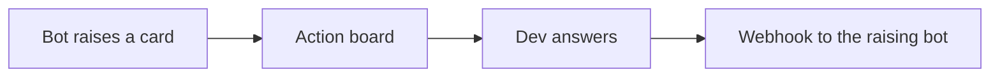
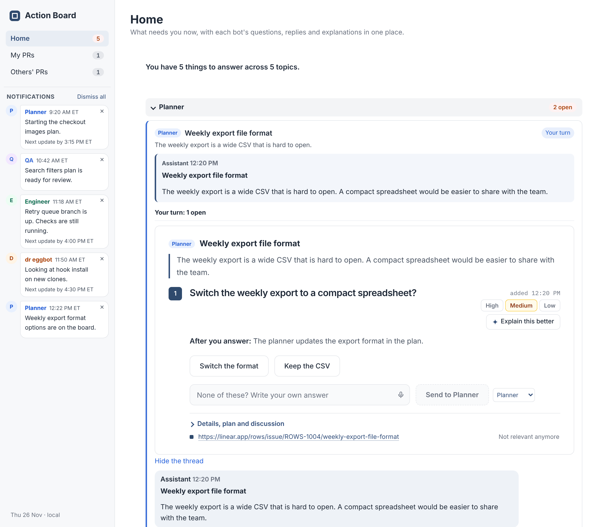
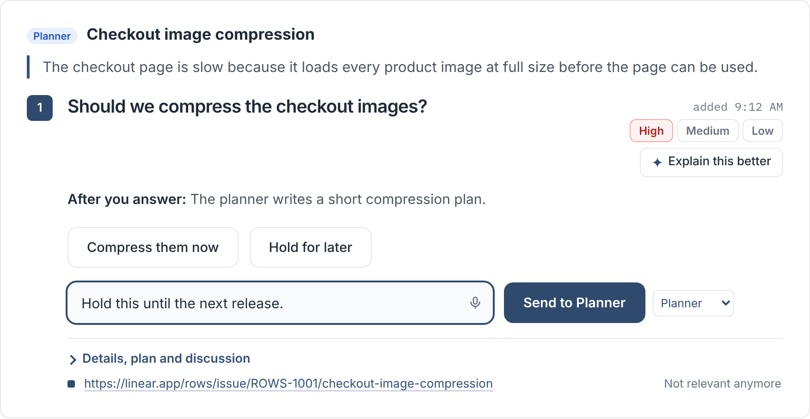
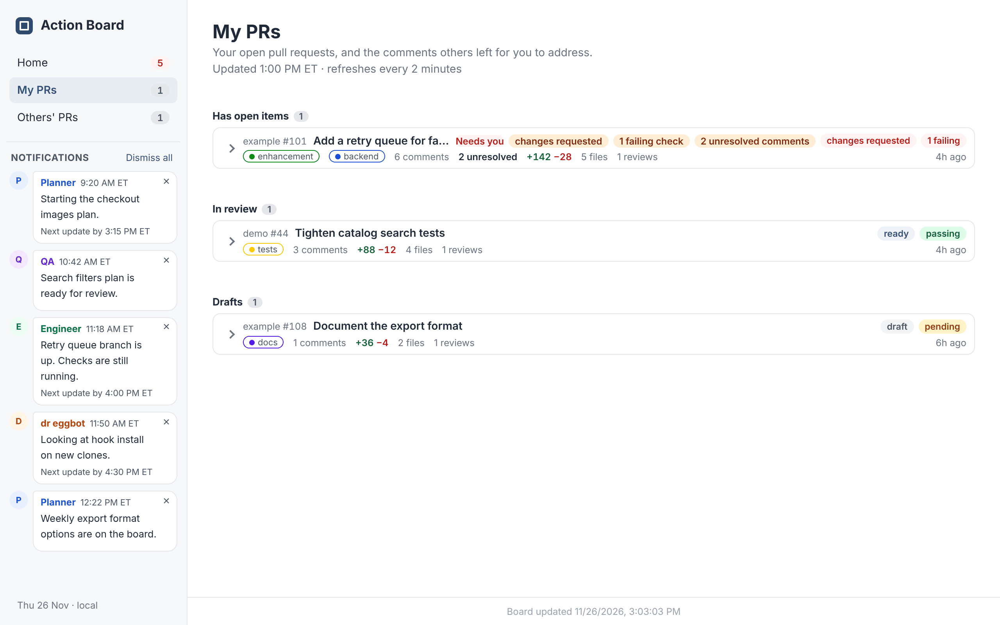

# Agent Board

An action board for a dev and the small team of AI bots that work with them on the rows-backend codebase: Planner, QA, Engineer, dr eggbot, and Grok Bot.

## The problem

The bots' questions to the dev used to be scattered across chats, often relayed through another bot, and easy to miss. Work stalled waiting on the dev's answer, and the answer sometimes got garbled in the relay. The dev became the scheduler: chasing bots, re-asking questions, and watching for loops.

## How the board solves it

Every bot raises a structured card in one place. The card says who raised it, what it's about, the options, and what happens after the dev answers. The dev answers on the card, and the answer goes straight to that bot through its own webhook. No bot sits in between.

The pipeline is Planner plans, QA approves the plan, then Engineer builds. Pushes to GitHub still need the dev's OK. Strict validation on `ab raise` makes cards hard to misuse. The PR and ticket tabs are filled by the server from free APIs, not by bots. Status updates go to the notifications feed.

Board state lives in SQLite: cards, answers, bot replies and threads on each card, and notifications. An hourly backup keeps a copy of that database.



The board is private. It is not a hosted product, and it is not on GitHub Pages. It runs on the dev's box and is reachable only over their tailnet.

## Principles

1. Grok Bot gives us our own always-on cloud computer, so it doubles as the server hosting the board.
2. Scheduled scripts on that computer are free, while bot runs cost usage, so anything a script can do runs as a script (feeds, routing, merges, backups, trimming), and bots only do judgment work.
3. Every bot-to-bot hop costs usage twice (sender plus receiver) and adds delay, so there is no chief-of-staff relay: the dev talks to each bot directly, and answers go from the board straight to the bot that asked.
4. Context is the main cost driver per run, so conversations live in the database and bots read a trimmed view instead of carrying chat history.
5. Bots follow instructions inconsistently, so important rules are enforced in code (strict card validation, the git push guard), not just written in prompts.
6. Waking a bot to check for nothing wastes usage, so everything is event-driven over polling.
7. The dev's attention is the bottleneck, so cards are built to decide in seconds: a plain explanation, a visual, and what happens after.

## What it looks like

The screenshots below use example data, not live work.







## Stack

Node 22.18+, Hono, `node:sqlite`, React and Vite.

The SQLite file is `AGENT_BOARD_DB` (default `./agent-board.db`). On the box it is `/workspace/agent-board-data/board.db`. The server serves the built UI from `ui/dist` on `localhost:8787`.

## Feed

`src/feed.ts` fills the My PRs and Others' PRs tabs itself. Every two minutes it runs a read-only `gh` GraphQL search, `org:ROWSHR` only, and stores the result in the `ui_feed` table. The UI reads it from `GET /__ab/board`. `POST /__ab/feed/refresh` runs a fetch now (rate-limited to once per 15 seconds). Linear is off (`LINEAR_FEED_ENABLED` in `src/feed.ts`); the My tickets tab is hidden.

## Routing

An answer or message is POSTed to `/__ab/webhook`. The server picks a destination in `src/routing.ts`: the bot in `to_bot`, else the card's author, else the fallback. Each bot's URL and secret are the env keys `AB_WEBHOOK_URL_<BOT>` and `AB_WEBHOOK_SECRET_<BOT>` (`PLANNER`, `QA`, `ENGINEER`, `EGGBOT`). The secret is sent as the `Authorization` header as written. Grok Bot's `AGENT_BOARD_WEBHOOK_URL` and `AGENT_BOARD_WEBHOOK_AUTH` are the fallback when the author is unknown or a bot has no key. `.env` is re-read on every send, so a key change needs no restart. URLs and secrets are never sent to the browser or logged.

## CLI

Run it with `node --env-file=.env bin/ab.mjs …`. Never `source .env`.

### `ab raise`

```sh
node --env-file=.env bin/ab.mjs raise --bot <Planner|QA|Engineer|dr eggbot|Grok Bot> '<json>'
```

`--bot` or `raised_by` in the JSON is required. A re-raise may omit it only when the card already has a stored author. The `id` must start with that bot's prefix (`planner-`, `qa-`, `engineer-`, `eggbot-`, `grok-`). Also required:

- `title`, `context`, `question`
- `what_happens_after` (plain words, at least four)
- `priority`: `high`, `medium`, or `low`
- `group`: a ticket key (`ROWS-1234`) or a PR (`#1234` or `repo#1234`)
- `card_ref` or `link`: a Linear URL whose key matches the ticket group, or a `https://github.com/ROWSHR/<repo>/pull/<number>` URL that matches the PR group
- at least two options with unique ids and none preselected, unless this is a free-text card (`allowCustom: true` and no options)

`svg` is optional. Unknown fields are rejected. A failed raise exits 2 and leaves the board untouched.

### Other commands

| command | what it does |
| --- | --- |
| `notify --bot <name> --text "..." [--next "1:15 PM ET"] [--link url]` | Post a short Markdown status note to the sidebar notifications feed. Clearing one never wakes a bot. |
| `answer`, `reply`, `read` | Record an answer or reply, or mark the human's messages on an item as read. |
| `clear`, `restore`, `priority` | Tombstone a card, put it back, or set high/medium/low. |
| `project-refresh` | Fill the Project tab. |
| `assistant` | Post a Dr. Assistant finding. |

Also: `glance`, `mypr`, `reviews`, `review-status`, `gh-refresh`, `detail`, `ticket`, `ticket-summaries`, `plan`, `supersede`, `already-answered`, `wipe`, `drop-bulk-options`, `ask`, `open`, `check`, `lint`, `backfill-stamps`, `backfill-titles`. Run `ab` with no arguments for usage. The PR tabs are no longer filled by `ab glance`, `ab mypr`, or `ab gh-refresh`.

`bin/board.ts` still has the older task, note, wake, tick, report, and `dev-merge` commands.

## UI

A React app in `ui/`, built into `ui/dist` and served by the same process.

The sidebar is Home, My PRs, and Others' PRs, plus a Project tab once `ab project-refresh` has data. Home holds the decision cards, grouped in collapsible sections by the raising bot, with a Send control aimed at that bot (or another bot the person picks). Notifications are a chat-style feed under the tab list; an X or Dismiss all clears a note and never wakes a bot. My tickets is hidden while Linear is off. `#conversation` and `#tickets` open Home; `#reviews` opens Others' PRs.

## Running

Needs Node 22.18 or newer.

```sh
npm run setup            # installs both packages and builds the UI into ui/dist
# copy .env.example to .env and fill in; do not source .env
npm start                # node --env-file-if-exists=.env src/server.ts  —  localhost:8787
```

On the box, `/workspace/agent-board-ops/start.sh` (the live copy of `ops/start.sh` in the private `aribennett1/eric-skills` repo) starts Tailscale if needed, serves port 8787 on the tailnet, and runs the board under `supervise-board.sh` in tmux session `agent-board`. This repo keeps versioned copies in `scripts/`. The supervisor restarts `npm start` if the process exits. Stop the board with `tmux kill-session -t agent-board`.

```sh
npm test                 # server and CLI, node:test
npm test --prefix ui     # UI, vitest
npm run typecheck
```

CI runs typecheck and the server/CLI tests on Node 22 for every push and pull request.

The board has no login. Do not expose it to the internet. Keep `.env` and the database out of git (both are git-ignored).

## Backups

An hourly dump of the live database is committed to the private `aribennett1/eric-skills` repo as `backups/board.sql`. `start.sh` keeps that loop running in tmux session `board-backup`. It never commits `.env`, tokens, or webhook secrets. Box restore notes are in that repo's `ops/RESTORE.md`.

## License

MIT
