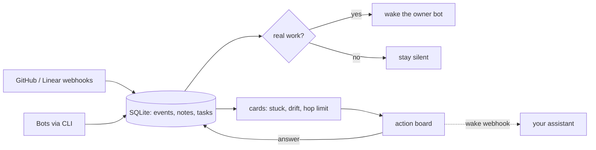

# Agent Board

A small, event-driven task board for a team of AI coding bots and one human.

**Live site:** https://aribennett1.github.io/agent-board/

## The problem

If you run several AI coding bots (a planner, an engineer, a reviewer) the obvious setup is routines that wake up on a timer and poll. It goes wrong in predictable ways:

- **It burns usage.** Most wake-ups find nothing to do, and each one pays for a full context load.
- **Work gets lost.** Nobody owns the handoff, so tasks stall between bots and nobody notices.
- **State drifts.** The bots' idea of a task falls out of sync with the issue tracker and GitHub.
- **The human becomes the scheduler.** You chase bots, re-ask questions, and watch for loops.

## The approach

Scripts do everything they can for free. A bot is woken only when there is real work for it.

- **Event-driven, with scripts as backstops.** GitHub and Linear webhooks, notes and state changes are events. An hourly `tick` catches whatever slipped through.
- **A SQLite notes table.** Every note carries its author. A trigger refuses an update or delete by the wrong author, and notes are append-only (an edit is a new note that supersedes the old one).
- **One wake per task per 30-second batch**, only to the current owner, never to the bot that caused the event.
- **Liveness check-ins.** A woken bot must check in within 2 minutes and write something within 20. Otherwise: one re-wake, then a card for the human.
- **Hop limits.** After 2 review rounds with no pass the script stops waking bots and hands the task to the human.
- **A drift check** compares the board with the tracker and GitHub and raises a card on any mismatch.
- **A weekly bottleneck report** shows wakes, estimated tokens per bot, re-wakes, hop-limit hits and where time was spent waiting.
- **The action board is the human's single inbox.** Anything that needs a person lands there, and a red dot in the tab tells you to come back. Answers go to the owning bot, and you can message the assistant from any text box, by typing or by voice.



## Quick start

Needs Node 22.18 or newer.

```sh
npm ci
cp .env.example .env     # optional, every setting has a default
npm start                # board UI, webhooks and API on http://localhost:8787
```

Add a task and look at it:

```sh
export AGENT_BOT=human
node bin/board.ts task add T1 --title "Choose a database" --state waiting_human
node bin/board.ts note T1 --kind info "Postgres or SQLite?"
```

Open http://localhost:8787. The tab shows a red dot while anything waits for you.

The sender is in **shadow mode**: it logs who it would wake and calls nothing. Plug your own sender into `printSender` in `src/board.ts` when you are ready.

## Board UI

- **Auto-refresh.** Every 10 seconds, and when you come back to the tab, the board asks a small version endpoint for a content hash. If the hash is the same, nothing moves. If it changed, only the parts that changed are swapped in. Checks never overlap, they wait while you are typing or the mic is recording, and they keep your scroll position. The red dot and favicon update from the same poll.
- **Red dot.** The favicon and tab title change while a task waits for you, and update live without a reload.
- **Microphone.** Every text box has a mic button (Chrome, Safari) that types what you say at the cursor. It never sends by itself. Browsers without speech recognition show a hint.
- **Every text box can wake your assistant.** An answer, or a free-text message, is POSTed to your wake webhook from the server, so the URL and secret never reach the browser.

## Configuration

All settings are environment variables (see `.env.example`). A bad value stops the server at start with a message naming the variable.

| Variable | Purpose | Default |
| --- | --- | --- |
| `AGENT_BOARD_DB` | SQLite file | `./agent-board.db` |
| `PORT` | HTTP port, 1 to 65535 | `8787` |
| `GITHUB_WEBHOOK_SECRET` | Require a valid `X-Hub-Signature-256` on GitHub webhooks | off |
| `AGENT_BOARD_WEBHOOK_URL` | Wake webhook, secret | off |
| `AGENT_BOARD_WEBHOOK_AUTH` | Sent as the `Authorization` header, secret | none |
| `AGENT_BOARD_ASSISTANT_NAME` | Name shown in the UI | `your assistant` |
| `AGENT_BOT` | Identity for CLI writes, instead of `--bot` | none |
| `AGENT_BOARD_BASE`, `AGENT_BOARD_GH_AUTHOR`, `AGENT_BOARD_HOOKS_INSTALL` | `dev-merge` settings | `main`, `@me`, none |

The bots are `planner`, `engineer`, `qa`, `ops` and `chief`. `human` is you and `script` is the board itself.

## CLI

| command | what it does |
| --- | --- |
| `checkin <task> --bot <id>` | First thing a bot runs on wake. |
| `note <task> --bot <id> --kind <kind> [--supersedes <id>] <body>` | Append a note. |
| `state <task> --bot <id> [--new-cycle] <state>` | Hand the task off. |
| `task add <id> --title <t> [--ticket <key>] [--pr n] [--state s]` | Create a task. |
| `wake` | Process pending events now. |
| `tick [--drift <file>]` | Hourly backstop: wake, liveness, failed sends, drift. Safe to repeat. |
| `drift <file>` | Compare with a JSON array of `{task, linear: {status, labels}, github: {state, checks}}`. |
| `report [--since ISO]` | Weekly bottleneck report in markdown. |
| `dev-merge --repo <path>` | Merge the base branch into your open PR branches, check, and push. |

Note kinds: `started answer question work review_pass review_changes pass_through info`.
States and owners: `planning`→planner, `plan_review`→qa, `building`→engineer, `qa_review`→qa, `waiting_human`, `merged` and `done`→nobody.

## dev-merge

`node bin/board.ts dev-merge --repo <checkout>` keeps your open PR branches current. It lists them with `gh pr list --author <you>`, merges `origin/<base>` into each in a temporary worktree, runs your checks, and pushes only if all pass. Conflicts and failures become one note per problem and at most one engineer wake. Defaults: base `main`, checks `npm ci`, `npm run lint --if-present`, `npm test` (override with `--check name=cmd`). Pushing goes through hooks (`--install-cmd`, `--stamp-cmd`, `--push-cmd`) so you decide what a safe push is.

## HTTP

- `POST /webhooks/github` is deduped by `X-GitHub-Delivery`. `POST /webhooks/linear` is deduped by `Linear-Delivery` and feeds drift only.
- `GET /api/tasks`, `GET /api/tasks/:id`, `POST /api/tasks/:id/answer` `{"body"}`, `POST /api/tasks/:id/message` `{"text"}`.

## Tests

```sh
npm test            # node:test, no extra services
npm run typecheck
```

CI runs both on Node 22 for every push and pull request.

## Security

- **The board has no login.** Run it behind an auth proxy such as Cloudflare Access (Tunnel plus an email sign-in) and never expose it directly to the internet.
- Browser writes from another origin are refused, but that is not a substitute for the proxy.
- The wake webhook URL and auth value stay on the server. Keep them in `.env` or your process manager, never in git. `.env` and database files are git-ignored.
- Set `GITHUB_WEBHOOK_SECRET` before pointing GitHub at the server. Linear signatures are not verified yet, so put Linear behind your proxy rules too.

## License

MIT
